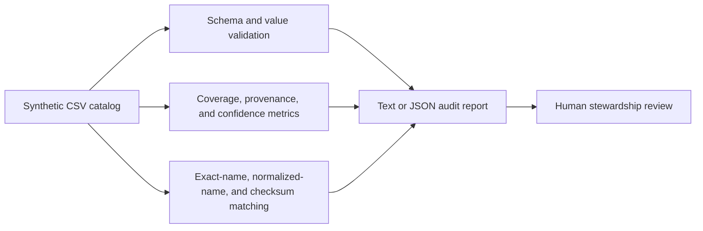

# Digital Asset Governance Audit

[](https://github.com/Jnapier2/digital-asset-governance-case-study/actions/workflows/ci.yml)

A deterministic, read-only Python audit that turns a digital-asset inventory into measurable data-quality signals and a human review queue. The repository uses only synthetic records and the Python standard library.

## Demonstrated outcome

Running the included fixture produces these deterministic sample results:

- **8 of 8 records pass schema and value validation.**
- **75% have documented provenance** (`verified` or `partial`); 50% are fully verified.
- **100% have source-reference and review-date coverage; 75% have SHA-256 coverage.**
- **Mean confidence is 0.74**, with four high-, two medium-, and two low-confidence records.
- The review queue contains **one exact-name group, two normalized-name groups, and one exact-checksum group**.

These are fixture results, not claims about a production catalog. The deliberately imperfect sample demonstrates how the tool surfaces governance work without exposing private records.

## Why this project exists

Asset inventories often mix authoritative records, partial imports, inconsistent filenames, and uncertain provenance. That makes basic questions—what is covered, what can be trusted, and what may be duplicated—expensive to answer.

This case study encodes a compact, repeatable audit:



The tool never changes the catalog. Duplicate matches are candidates for review, not automatic deletion decisions.

## Run it

Python 3.11 or newer is recommended; there are no third-party runtime dependencies.

```powershell
python catalog_audit.py tests/fixtures/synthetic_catalog.csv
python catalog_audit.py tests/fixtures/synthetic_catalog.csv --format json
python -m unittest discover -s tests -v
```

The command exits with `0` when validation passes, `1` when schema or row validation fails, and `2` when the file cannot be audited. Low confidence and duplicate candidates remain review signals and do not make an otherwise valid catalog fail.

## Audit model

The CSV contract requires:

| Area | Fields and rules |
|---|---|
| Identity | Unique safe `asset_id`; label-only `artifact_name` with no path |
| Type and source | Controlled `asset_type` and `source_system`; opaque safe `source_reference` |
| Stewardship | Role-based `owner_role`; controlled `classification`; ISO review date |
| Provenance | `verified`, `partial`, or `unknown` |
| Confidence | Numeric score from 0 through 1; high is `>= 0.85`, medium is `>= 0.60`, lower scores enter review |
| Integrity | Optional 64-character SHA-256 digest |

Normalization applies Unicode NFKC, case folding, extension removal, punctuation-to-space conversion, and whitespace collapsing. It deliberately preserves version numbers and dates to limit false positives.

## Privacy and data boundary

Every asset name, identifier, role, source reference, date, and checksum in this repository is invented for the fixture. The repository contains no live source rows, provider IDs, personal names, email addresses, permissions, machine paths, credentials, or private filenames.

## Project structure

```text
catalog_audit.py                 # Audit library and command-line interface
tests/test_catalog_audit.py      # Validation, metric, and matching tests
tests/fixtures/synthetic_catalog.csv
.github/workflows/ci.yml         # Compile, test, and fixture audit
```

## Design limits

- Name matching is deterministic and conservative; it is not fuzzy or semantic entity resolution.
- Checksum matching can only assess records that already have checksums.
- Confidence thresholds are explicit demonstration policy, not universal DAM standards.
- The tool audits one CSV snapshot and does not connect to a live provider or write remediations.

## License

Copyright © 2026 Gateway Information Group LLC. All rights reserved. See [LICENSE.md](LICENSE.md).
