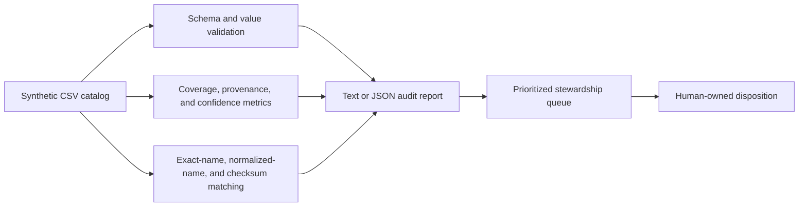

# Digital Asset Governance Audit

[](https://github.com/Jnapier2/digital-asset-governance-case-study/actions/workflows/ci.yml)

[Portfolio](https://jerry-napier-portfolio.netlify.app/) · [GitHub profile](https://github.com/Jnapier2)

Digital Asset Governance Audit turns catalog-quality questions into reviewable decisions. The deterministic, read-only Python tool reports schema health, provenance coverage, confidence distribution, and duplicate candidates, then converts those signals into a prioritized stewardship queue without changing source records. It uses only the Python standard library and includes a synthetic fixture.

## Fixture results

Running the included fixture produces these deterministic sample results:

- **8 of 8 records pass schema and value validation.**
- **75% have documented provenance** (`verified` or `partial`); 50% are fully verified.
- **100% have source-reference and review-date coverage; 75% have SHA-256 coverage.**
- **Mean confidence is 0.74**, with four high-, two medium-, and two low-confidence records.
- The review queue contains **one exact-name group, two normalized-name groups, and one exact-checksum group**.
- The unified stewardship queue prioritizes **two high-risk and five medium-risk records**; each item includes the evidence signals and a controlled next step.

These are fixture results, not claims about a production catalog. The sample includes incomplete provenance, missing checksums, and duplicate candidates so each audit path has deterministic coverage.

## Audit questions

Asset inventories can combine authoritative records with partial imports, inconsistent filenames, and uncertain provenance. The audit answers three questions: which records satisfy the schema, which fields have evidence coverage, and which records require duplicate review.

The pipeline is read-only and separates evidence from authority:



The tool never changes the catalog. Duplicate matches are candidates for review, not automatic deletion decisions. High-priority items combine weak identity evidence, unknown provenance, or low confidence; medium-priority items surface duplicate signals for comparison; partial provenance alone enters the next routine stewardship review.

Every queued item carries machine-readable reason codes and a conservative next step. This turns a broad quality report into an ordered workload while keeping reuse, relocation, merge, and deletion decisions with a person.

## Run it

Python 3.11 or newer is recommended; there are no third-party runtime dependencies.

```powershell
python catalog_audit.py tests/fixtures/synthetic_catalog.csv
python catalog_audit.py tests/fixtures/synthetic_catalog.csv --format json
python -m unittest discover -s tests -v
```

The command exits with `0` when validation passes, `1` when schema or row validation fails, and `2` when the file cannot be audited. Low confidence and duplicate candidates remain review signals and do not make an otherwise valid catalog fail.

## Audit model

CSV headers must be unique. Ambiguous duplicate headers stop row interpretation rather
than silently choosing one value; the zero evaluated records in that error report do
not describe the size of the source catalog. Every row must contain the header's
number of fields. An optional checksum may be explicitly blank, but a missing
trailing field is a structural error. UTF-8 (with or without a BOM), quoted commas,
and quoted newlines are supported; unterminated quoted fields and invalid encoding
produce an audit error. Review dates must use valid `YYYY-MM-DD` calendar dates,
not compact or week-date alternatives. The tool still leaves input bytes unchanged.

The CSV contract requires:

| Area | Fields and rules |
|---|---|
| Identity | Unique safe `asset_id`; label-only `artifact_name` with no path |
| Type and source | Controlled `asset_type` and `source_system`; opaque safe `source_reference` |
| Stewardship | Controlled `owner_role` (`Experience`, `Governance`, `Operations`, or `Strategy`); controlled `classification`; ISO review date |
| Provenance | `verified`, `partial`, or `unknown` |
| Confidence | Numeric score from 0 through 1; high is `>= 0.85`, medium is `>= 0.60`, lower scores enter review |
| Integrity | Optional 64-character SHA-256 digest |

Normalization applies Unicode NFKC, case folding, extension removal, punctuation-to-space conversion, and whitespace collapsing. It deliberately preserves version numbers and dates to limit false positives.

The catalog must contain at least one data record. The controlled owner vocabulary keeps stewardship labels role-based and prevents names, email addresses, and other free-text personal identifiers from entering that field. A production implementation can revise `ALLOWED_OWNER_ROLES` through a governed schema change.

## Data boundary

The included dataset is a synthetic fixture. It contains no live catalog rows or operational identifiers and covers only the fields required to exercise validation, metrics, and match generation.

## Project structure

```text
catalog_audit.py                 # Audit library and command-line interface
tests/test_catalog_audit.py      # Validation, metric, and matching tests
tests/fixtures/synthetic_catalog.csv
.github/workflows/ci.yml         # Compile, test, and fixture audit
```

## Design limits

- Name matching is deterministic and conservative; it is not fuzzy or semantic entity resolution.
- Checksum matching can only assess records that already have checksums.
- The stated confidence thresholds are specific to this audit model, not universal DAM standards.
- Queue priority organizes human review; it is not a retention decision, risk certification, or automated remediation.
- The tool audits one CSV snapshot and does not connect to a live provider or write remediations.

## License

Copyright © 2026 Gateway Information Group LLC. All rights reserved. See [LICENSE.md](LICENSE.md).
